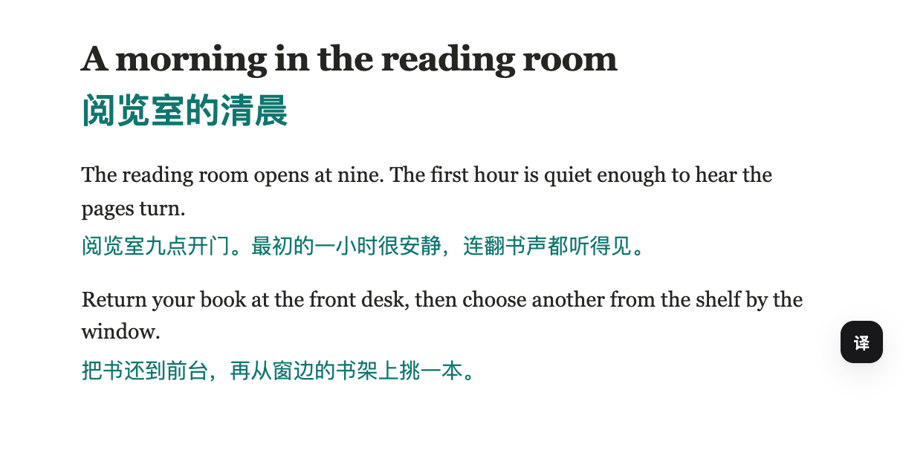

# Lens Translate

[中文使用说明](README.md)

Read a page with a translation under each paragraph, or select a phrase to translate on its own. Lens connects to a model service you choose. You can use a cloud API key or run a model on your computer.

## Install in Chrome

1. Download the built extension and extract it to a folder you intend to keep. [Download Lens Translate 1.0.0 (ZIP)](downloads/lens-translate-1.0.0.zip?raw=true)
2. In Chrome 114 or later, open `chrome://extensions`, turn on **Developer mode**, click **Load unpacked**, and select the folder that directly contains `manifest.json`.
3. Open the puzzle-piece menu in the Chrome toolbar and pin Lens. Click its icon, then the gear in the top right of the popup.

## Connect a model

| | Cloud example · DeepSeek | Local example · Ollama |
| --- | --- | --- |
| Before you start | Create a key in your DeepSeek API account. API usage is billed by the provider. [Create a key](https://platform.deepseek.com/api_keys) | Install and start Ollama on the same computer as Chrome. Run `ollama pull qwen2.5:7b`, then check the exact model name with `ollama ls`. [Get Ollama](https://ollama.com/download) |
| Provider preset | `DeepSeek` | `Custom` |
| Protocol | OpenAI compatible | OpenAI compatible |
| Endpoint | `https://api.deepseek.com/chat/completions` (prefilled) | `http://localhost:11434/v1` |
| API key | Your DeepSeek key | Leave blank for the default local installation |
| Model | `deepseek-flash` (prefilled) | `qwen2.5:7b` or the exact name shown by `ollama ls` |

Choose a target language under **Translate**. The default is Simplified Chinese. Click **Test connection** and wait for a sample translation, then click **Save settings**.

If Ollama returns `403`, copy the extension ID from `chrome://extensions`, add `chrome-extension://YOUR_EXTENSION_ID` to Ollama’s `OLLAMA_ORIGINS`, and restart Ollama. [Ollama origin settings](https://docs.ollama.com/faq#how-can-i-allow-additional-web-origins-to-access-ollama)

## Try it

Open an article in a language different from your target. Click the floating button at the bottom right or **Translate this page** in the popup. Use **Restore original** to return to the original. To translate a phrase, select it and click **Translate selection**. If the tab was open during installation, reload it first.

## Data and development

Lens sends text, the target language, applicable glossary terms, and sometimes the page title and hostname to your configured endpoint. Automatic translation is off by default. API keys, preferences, and cached translations are stored in the browser. Clearing the translation cache and exporting settings are available in Settings. The API key is included in a backup only if you explicitly select the plain-text export option.

To build from source, use Node.js 22.12+ LTS and run `npm ci`, then `npm run build`. Load the resulting `dist/` folder in Chrome. Run `npm run typecheck` and `npm test` to check changes, or `npm run package` to rebuild the downloadable ZIP. [MIT license](LICENSE)
