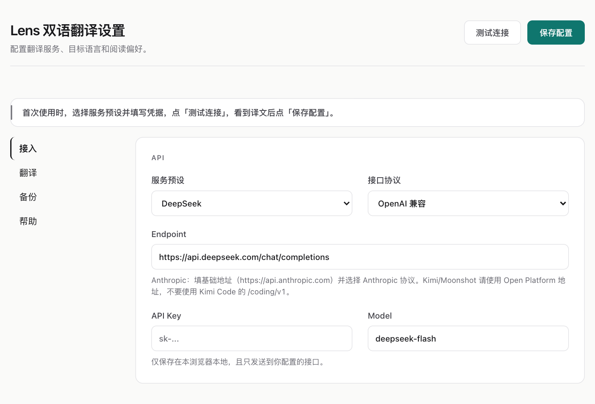

# Lens Translate · 双语翻译

在 Chrome 里读外语网页时，Lens 可以把译文放在每段原文下方。只想看懂一句话，就选中它单独翻译。翻译使用你自己的模型服务，既可以接云端 API，也可以接电脑上的本地模型。

## 安装到 Chrome

如果手中已有包含 `manifest.json` 的 `dist/` 文件夹，可以直接从第 2 步开始。

1. **从源码构建**。下载或克隆本仓库，在含有 `package.json` 的目录打开终端。如果电脑还没有 npm，可安装 Node.js 的 LTS 版本，它自带 npm。运行以下两条命令。[Node.js 下载](https://nodejs.org/zh-cn/download)

   ```sh
   npm ci
   npm run build
   ```

2. **加载扩展**。使用 Chrome 114 或更高版本，在地址栏输入 `chrome://extensions`，打开「开发者模式」，点「加载已解压的扩展程序」，选中 `dist/`。列表中应出现「Lens 双语翻译」。
3. **打开设置**。点 Chrome 工具栏的拼图图标，找到 Lens 并固定。点 Lens 图标，再点弹窗右上角的齿轮 ⚙。

## 第一次配置

### 使用 DeepSeek

1. 登录 DeepSeek 开放平台，在 API keys 页面创建密钥并复制。云端调用使用该 API 账户的额度。[创建 API Key](https://platform.deepseek.com/api_keys) · [DeepSeek 接入说明](https://api-docs.deepseek.com/zh-cn/)
2. 在 Lens 设置左侧选「接入」，把「服务预设」切到 **DeepSeek**。检查下表，通常只需自己填入密钥。

   | 设置项 | 填写内容 |
   | --- | --- |
   | 服务预设 | `DeepSeek` |
   | 接口协议 | `OpenAI 兼容`，由预设填入 |
   | Endpoint（请求地址） | `https://api.deepseek.com/chat/completions`，由预设填入 |
   | API Key | 粘贴刚创建的密钥 |
   | Model（模型 ID） | `deepseek-flash`，由预设填入 |

   

3. 默认目标语言为「简体中文」，显示模式为「双语对照」。要换语言，可在左侧「翻译」中修改「目标语言」。
4. 点右上角 **「测试连接」**。看到「连接正常」和一段测试译文后，再点 **「保存配置」**。出现「配置已保存」就可以关掉设置页。

已有其他服务商的 API Key 时，可在「服务预设」中选对应服务商，填入它的密钥和账号可用的模型 ID。自建服务选 `Custom`，按服务端提供的接口选择「OpenAI 兼容」（Chat Completions）或「Anthropic（Claude）」（Messages）。

### 使用本机 Ollama

1. 在运行 Chrome 的同一台电脑上安装并启动 Ollama。打开终端下载一个模型，再用 `ollama ls` 查看已安装模型的名称。下例下载的模型约 4.7 GB。[安装 Ollama](https://ollama.com/download) · [示例模型](https://ollama.com/library/qwen2.5:7b)

   ```sh
   ollama pull qwen2.5:7b
   ollama ls
   ```

2. 在 Lens「接入」中选 `Custom`，协议选「OpenAI 兼容」，Endpoint 填 `http://localhost:11434/v1`，Model 填 `qwen2.5:7b`。若使用其他已下载的模型，填 `ollama ls` 中对应的完整名称。本机默认配置下，API Key 留空。[Ollama 接口说明](https://docs.ollama.com/api/openai-compatibility)
3. 点「测试连接」，看到译文后点「保存配置」。如果返回 `403`，在 `chrome://extensions` 复制 Lens 的扩展 ID，把 `chrome-extension://你的扩展ID` 加入 Ollama 的 `OLLAMA_ORIGINS`，重启 Ollama 后重试。[Ollama 浏览器扩展配置](https://docs.ollama.com/faq#how-can-i-allow-additional-web-origins-to-access-ollama)

   macOS 桌面版遇到上述 `403` 时，可用下面的命令添加来源。先把「你的扩展ID」换成刚复制的值。若已有其他允许的来源，用英文逗号保留在同一个值里。运行后从菜单栏退出并重新打开 Ollama。[Ollama 各系统环境变量说明](https://docs.ollama.com/faq#how-do-i-configure-ollama-server)

   ```sh
   launchctl setenv OLLAMA_ORIGINS "chrome-extension://你的扩展ID"
   ```

## 翻译第一篇网页

打开一篇英文文章，例如 MDN 的 JavaScript 入门文档。点网页右下角的 **「译」**，或打开 Lens 弹窗点 **「翻译当前页面」**。稍等片刻，正文原文下方就会逐段出现译文。点「恢复原文」可以切回原页面。[打开 MDN 英文文章](https://developer.mozilla.org/en-US/docs/Web/JavaScript/Guide/Introduction)


| 想做什么 | 怎么操作 |
| --- | --- |
| 只翻一句 | 鼠标选中文字，点出现的「翻译选中文本」。结果面板里可以复制或朗读译文。 |
| 用快捷键 | `Alt+T` 翻译整页或还原，`Alt+S` 翻译选中内容。macOS 上使用 `Option`。可在 `chrome://extensions/shortcuts` 修改。 |
| 只看译文 | 在弹窗的「显示模式」中点「仅显示译文」。点「双语对照」可切回来。 |
| 让一个网站自动翻译 | 在该网站打开弹窗，开启下方标有当前域名的「自动翻译」。以后浏览这个站点时，滚动出现的新段落也会翻译。 |
| 控制选中文字后是否弹出按钮 | 弹窗里的「本站划词工具条」可选「自动」「手动」「关闭」。手动模式下，先选文字，再用右键菜单「打开划词工具条」。 |
| 固定术语译法 | 在「设置 → 翻译 → 术语表」每行写一组，例如 `cache=缓存`，然后点「保存配置」。 |

## 遇到问题

| 现象 | 可以检查什么 |
| --- | --- |
| 加载扩展时提示缺少清单文件 | 运行 `npm run build`，确认 `dist/manifest.json` 存在，然后在 Chrome 中选 `dist/`。 |
| 测试连接返回 `401` 或提示模型不存在 | 核对密钥是否属于所选服务商，Endpoint 是否是 API 地址，Model 是否与服务商列出的模型 ID 完全一致。 |
| 测试成功，回到网页却仍提示配置 API | 回设置点「保存配置」，等到出现保存提示，再回网页重试。 |
| `429` 或本机模型频繁超时 | 到「翻译 → 速度与并发」降低「最大并发请求数」。本机模型首次加载较慢时，也可以调高「请求超时（毫秒）」。 |
| 页面没有出现译文 | 在普通 HTTP 或 HTTPS 网页上试一段外语正文。默认会跳过已是目标语言的文字。扩展重新加载后，先刷新原来打开的网页。 |

## 数据与权限

扩展直接向所选模型接口发送待翻译的文字、目标语言和适用的术语，也可能附上页面标题和域名。自动翻译默认关闭。访问 HTTP 和 HTTPS 网站的权限用于读取网页文字、显示译文并连接配置的接口。

设置、API Key 和译文缓存在当前浏览器保存。「设置 → 翻译 → 缓存」可以清空译文。「设置 → 备份」导出的 `lens-settings.json` 含已填写的 API Key，请作为私密文件保管。

## 开发与许可证

```sh
npm run typecheck
npm test
npm run watch
```

修改代码后，在 `chrome://extensions` 的 Lens 卡片上点重新加载，再刷新测试网页。项目采用 [MIT 许可证](LICENSE)。
