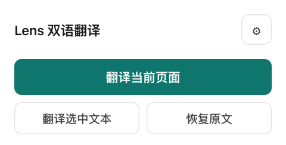
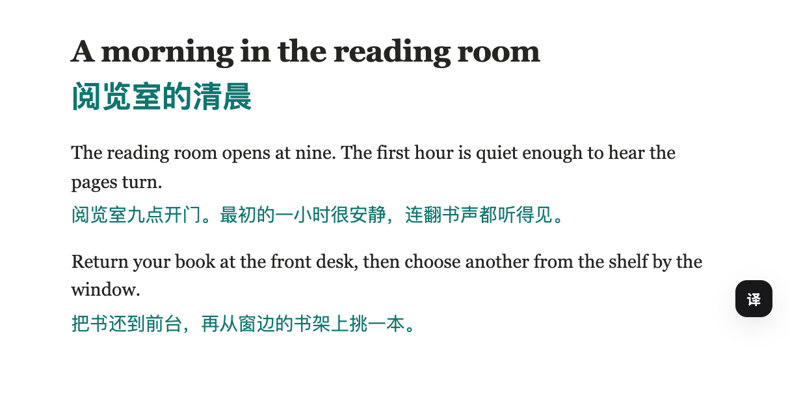
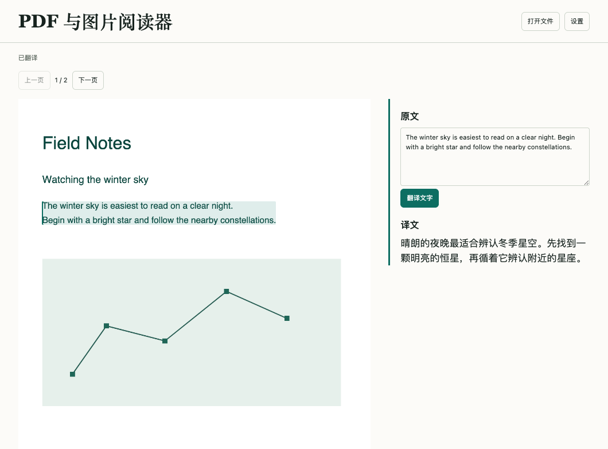

# Lens Translate · 双语翻译

[English quick start](README.en.md)

在 Chrome 里读外语网页时，Lens 可以把译文放在每段原文下方。只想看懂一句话，就选中它单独翻译。可以直接使用 Chrome 内置翻译，也可以接入自己的模型。Lens 还能翻译输入框草稿、YouTube 字幕、有文字层的 PDF 和截图。

## 安装到 Chrome

1. **下载安装包并解压**。这个 ZIP 已经构建好，可以直接安装。将它解压到一个准备长期保留的文件夹，打开后应能看到 `manifest.json`。[下载 Lens Translate 1.1.0（ZIP）](downloads/lens-translate-1.1.0.zip?raw=true)
2. **加载扩展**。使用 Chrome 114 或更高版本，在地址栏输入 `chrome://extensions`，打开右上角「开发者模式」，点「加载已解压的扩展程序」，选中刚才含有 `manifest.json` 的文件夹。列表中应出现「Lens 双语翻译」。
3. **打开设置**。点 Chrome 工具栏的拼图图标，找到 Lens 并固定。点 Lens 图标，再点弹窗右上角的齿轮 ⚙。

   

## 第一次配置

### 先试用 Chrome 内置翻译

首次安装可以直接试用。用桌面 Chrome 138 或更高版本打开一篇 HTTPS 英文文章，在 Lens 弹窗点「翻译当前页面」。首次使用某个语言对时，网页会出现「下载语言包」按钮。下载完成后，译文在本机生成。默认阅读目标是简体中文，可在「设置 → 翻译」更改。设备、浏览器策略和语言对都会影响可用性。[Chrome 内置翻译说明](https://developer.chrome.com/docs/ai/translator-api)

要查看词语在原句中的解释、让长网页共用术语，或使用 Chrome 暂不支持的语言对，可以配置下面任一模型。已经配置模型的用户可到「设置 → 接入」把「当前使用」改为「Chrome 内置翻译」并保存。

### 使用 DeepSeek

1. 登录 DeepSeek 开放平台，在 API keys 页面创建密钥并复制。云端调用使用该 API 账户的额度。[创建 API Key](https://platform.deepseek.com/api_keys) · [DeepSeek 接入说明](https://api-docs.deepseek.com/zh-cn/)
2. 在 Lens 设置左侧选「接入」，把「服务预设」切到 **DeepSeek**。检查下表，通常只需自己填入密钥。

   | 设置项 | 填写内容 |
   | --- | --- |
   | 服务预设 | `DeepSeek` |
   | 接口协议 | `OpenAI 兼容`，由预设填入 |
   | Endpoint（请求地址） | `https://api.deepseek.com/chat/completions`，由预设填入 |
   | API Key | 粘贴刚创建的密钥 |
   | Model（模型 ID） | `deepseek-flash`，由预设填入 |

   

3. 默认目标语言为「简体中文」，显示模式为「双语对照」。要换语言，可在左侧「翻译」中修改「目标语言」。
4. 点右上角 **「测试连接」**。看到「连接正常」和一段测试译文后，再点 **「保存配置」**。出现「配置已保存」就可以关掉设置页。

已有其他服务商的 API Key 时，可在「服务预设」中选对应服务商，填入它的密钥和账号可用的模型 ID。自建服务选 `Custom`，按服务端提供的接口选择「OpenAI 兼容」（Chat Completions）或「Anthropic（Claude）」（Messages）。

### 使用本机 Ollama

1. 在运行 Chrome 的同一台电脑上安装并启动 Ollama。打开终端下载一个模型，再用 `ollama ls` 查看已安装模型的名称。下例下载的模型约 4.7 GB。[安装 Ollama](https://ollama.com/download) · [示例模型](https://ollama.com/library/qwen2.5:7b)

   ```sh
   ollama pull qwen2.5:7b
   ollama ls
   ```

2. 在 Lens「接入」中选 `Custom`，协议选「OpenAI 兼容」，Endpoint 填 `http://localhost:11434/v1`，Model 填 `qwen2.5:7b`。若使用其他已下载的模型，填 `ollama ls` 中对应的完整名称。本机默认配置下，API Key 留空。[Ollama 接口说明](https://docs.ollama.com/api/openai-compatibility)
3. 点「测试连接」，看到译文后点「保存配置」。如果返回 `403`，在 `chrome://extensions` 复制 Lens 的扩展 ID，把 `chrome-extension://你的扩展ID` 加入 Ollama 的 `OLLAMA_ORIGINS`，重启 Ollama 后重试。[Ollama 浏览器扩展配置](https://docs.ollama.com/faq#how-can-i-allow-additional-web-origins-to-access-ollama)

   macOS 桌面版遇到上述 `403` 时，可用下面的命令添加来源。先把「你的扩展ID」换成刚复制的值。若已有其他允许的来源，用英文逗号保留在同一个值里。运行后从菜单栏退出并重新打开 Ollama。[Ollama 各系统环境变量说明](https://docs.ollama.com/faq#how-do-i-configure-ollama-server)

   ```sh
   launchctl setenv OLLAMA_ORIGINS "chrome-extension://你的扩展ID"
   ```

## 翻译第一篇网页

打开一篇英文文章，例如 MDN 的 JavaScript 入门文档。点网页右下角的 **「译」**，或打开 Lens 弹窗点 **「翻译当前页面」**。稍等片刻，正文原文下方就会逐段出现译文。点「恢复原文」可以切回原页面。[打开 MDN 英文文章](https://developer.mozilla.org/en-US/docs/Web/JavaScript/Guide/Introduction)



| 想做什么 | 怎么操作 |
| --- | --- |
| 只翻一句 | 鼠标选中文字，点出现的「翻译选中文本」。结果面板里可以复制或朗读译文。 |
| 用快捷键 | `Alt+T` 翻译整页或还原，`Alt+S` 翻译选中内容。macOS 上使用 `Option`。可在 `chrome://extensions/shortcuts` 修改。 |
| 只看译文 | 在弹窗的「显示模式」中点「仅显示译文」。点「双语对照」可切回来。 |
| 让一个网站自动翻译 | 在该网站打开弹窗，开启下方标有当前域名的「自动翻译」。以后浏览这个站点时，滚动出现的新段落也会翻译。 |
| 控制选中文字后是否弹出按钮 | 弹窗里的「本站划词工具条」可选「自动」「手动」「关闭」。手动模式下，先选文字，再用右键菜单「打开划词工具条」。 |
| 固定术语译法 | 在「设置 → 翻译 → 术语表」每行写一组，例如 `cache=缓存`，然后点「保存配置」。 |

## 按场景使用

| 场景 | 操作 |
| --- | --- |
| 只读一个段落 | 光标移到段落上，轻按一次 Alt（Mac 用 Option）显示译文，再按一次收起。可在「设置 → 翻译」改为 Shift 或关闭。 |
| 查词义 | 选中原句里的词或短语，再点「翻译选中文本」。模型会解释它在这句话里的含义。Chrome 模式会显示选词和整句的译文。 |
| 写评论或邮件 | 在「设置 → 翻译」设置写作目标语言，默认英语。在输入框里写好草稿，右键选择「翻译当前输入框」。写成 `/ja 明天见` 会临时译成日语。翻译后按 Esc 或在右键菜单点「恢复输入框原稿」可撤销。 |
| 读 GitHub issue 或 PR | 像平时一样翻译页面。内置规则选择标题、描述和评论，跳过代码与 diff。 |
| 长文中统一术语 | 配置模型后默认开启。长页面会多发一次请求，从正文节选中提取主题和最多 12 个术语，供后续批次使用。手填术语优先。可在「设置 → 翻译」关闭。 |
| 看 YouTube 字幕 | 在有字幕的视频中开启播放器的 CC，再点扩展弹窗的「开启双语字幕」。跳转进度或切换字幕后，译文跟随当前字幕。视频需要有字幕轨。 |
| 读 PDF | 在弹窗打开「PDF 与图片阅读器」，选择有文字层的 PDF，再点原页段落。右侧显示该段原文和译文，图表保留在原位。常见 PDF 链接可直接打开。受登录保护的文档请先保存到本机。 |
| 翻译报错截图或说明图 | 右键点图片，选择「识别并翻译图片」。侧栏会在本机识别文字并翻译。可切换英语、简体中文或日语识别，也可以修正原文再点「翻译文字」。阅读器也能打开本机图片。 |



## 遇到问题

| 现象 | 可以检查什么 |
| --- | --- |
| 加载扩展时提示缺少清单文件 | 确认下载的是上方的扩展安装包，已解压，并在文件选择器中选中了直接包含 `manifest.json` 的那一层。若下载的是仓库源码，按下方「开发与许可证」构建后选择 `dist/`。 |
| Chrome 未能加载语言包 | 检查网络后再次点击下载。打不开或设备受策略限制时，可在「设置 → 接入」选择云端或本地模型。 |
| 测试连接返回 `401` 或提示模型不存在 | 核对密钥是否属于所选服务商，Endpoint 是否是 API 地址，Model 是否与服务商列出的模型 ID 完全一致。 |
| 测试成功，回到网页却仍提示配置 API | 回设置点「保存配置」，等到出现保存提示，再回网页重试。 |
| 自建接口提示网络错误 | 检查服务是否运行，并填写最终的请求地址。扩展会拒绝 HTTP 重定向，避免密钥或网页内容被转发给其他地址。 |
| `429` 或本机模型频繁超时 | 到「翻译 → 速度与并发」降低「最大并发请求数」。本机模型首次加载较慢时，也可以调高「请求超时（毫秒）」。 |
| 页面没有出现译文 | 在普通 HTTP 或 HTTPS 网页上试一段外语正文。默认会跳过已是目标语言的文字。扩展重新加载后，先刷新原来打开的网页。 |

## 数据与权限

Chrome 内置模式在设备上翻译，语言包由 Chrome 下载。选择模型时，扩展直接向配置的接口发送待翻译文字、目标语言和适用术语，可能附上页面标题、域名、选词所在原句，以及长文术语分析所需的节选（最多 5,500 字符）。默认会先在本机替换能识别的邮箱和电话号码，收到译文后恢复。这项设置适用于两种接口协议，覆盖范围限于这些格式。图片识别和 PDF 解析在本机完成，模型收到的是识别或选中的文字。读取在线文件时，阅读器会请求文件的原地址。自动翻译默认关闭。访问 HTTP 和 HTTPS 网站的权限用于读取网页文字、显示译文并连接配置的接口。

设置、API Key 和译文缓存在当前浏览器保存。侧栏用于图片翻译，右键菜单用于图片、草稿和选中文字，当前标签页和脚本权限用于在打开的页面显示翻译。扩展请求本地存储和扩展存储额度，用于保存设置和较大的译文缓存。「设置 → 翻译 → 缓存」可以清空译文。

「设置 → 备份」默认导出偏好和站点规则。只有主动勾选「在导出文件中包含 API Key（明文）」才会把密钥写入 `lens-settings.json`。换设备恢复默认备份后，需要重新填写密钥。

## 开发与许可证

从源码构建时，安装 Node.js 22.13+ 的 LTS 版本及自带的 npm，在仓库根目录运行以下命令。[Node.js 下载](https://nodejs.org/zh-cn/download)

```sh
npm ci
npm run build
npm run typecheck
npm test
```

在 Chrome 中加载生成的 `dist/`。开发时可运行 `npm run watch`，修改后在扩展卡片上点重新加载，再刷新测试网页。`npm run package` 会重新构建并在 `downloads/` 生成可分发的 ZIP。

贡献站点规则时，编辑 [siteProfiles.json](src/features/translate/content/siteProfiles.json)。每条规则用 `host` 精确匹配域名、用 `path` 正则匹配路径、用 `include` 和 `exclude` CSS 选择器指定正文和例外区域。可参考 GitHub 规则，在 PR 中附上示例 URL，并说明应翻译和应跳过的元素。

扩展源码采用 MIT 许可证。安装包中 PDF、OCR 和字体的授权列在第三方声明中。[MIT 许可证](LICENSE) · [第三方声明](THIRD_PARTY_NOTICES.md)
